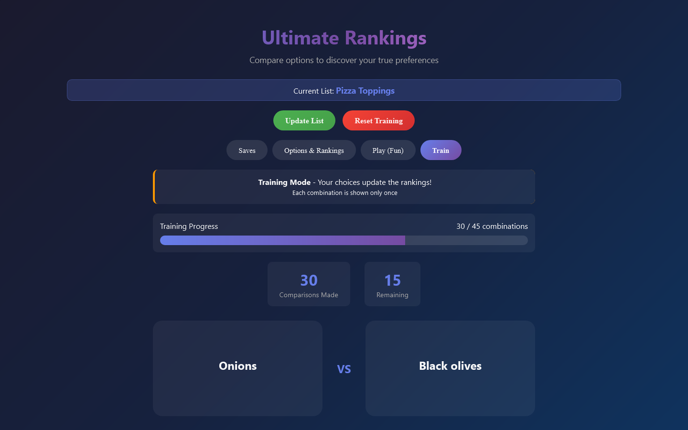
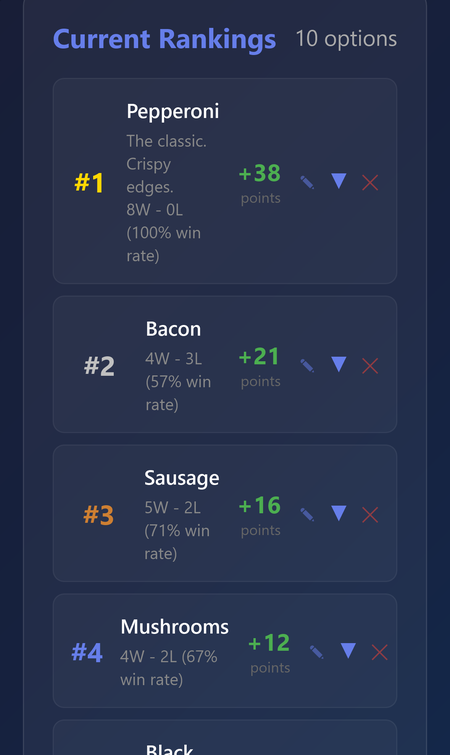
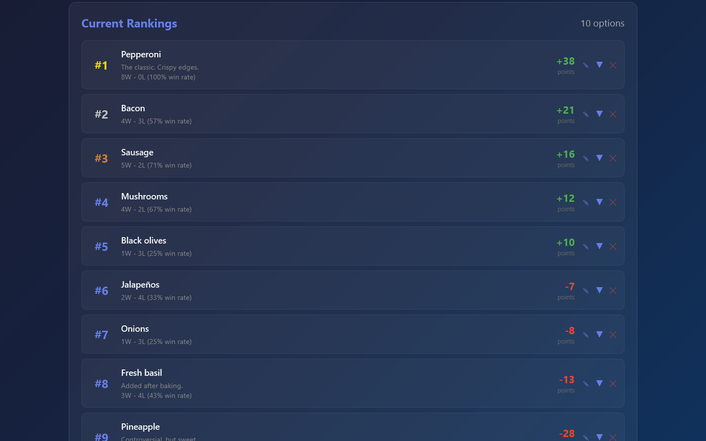

# Ultimate Rankings
Can't decide what you like best? Add your options, then pick between two at a time, and the app builds your ranking from your choices.

**[▶ Open the live app](https://timothyhadfield.github.io/rankings/)** · works on phone and laptop

  
  &nbsp;
  

  

## Features
- **Head-to-head choices**: tap the one you prefer out of two; Train mode shows every pair exactly once and tracks your progress.
- **Ranking that learns**: expected wins barely move the scores, while upsets move them a lot, so the order settles quickly.
- **Win-loss history**: expand any option to see what it beat and lost to, and remove a single comparison if you change your mind.
- **Play mode**: a just-for-fun round of close matchups that doesn't change your scores.
- **Multiple lists**: keep separate lists (food, movies, anything), switch between them, rename or delete them.
- **Private by default**: lists are saved in your own browser (press **Update List** to save your latest changes); nothing is sent anywhere.

## Built with
One HTML file: plain HTML, CSS and JavaScript with localStorage. No build step, no server.
